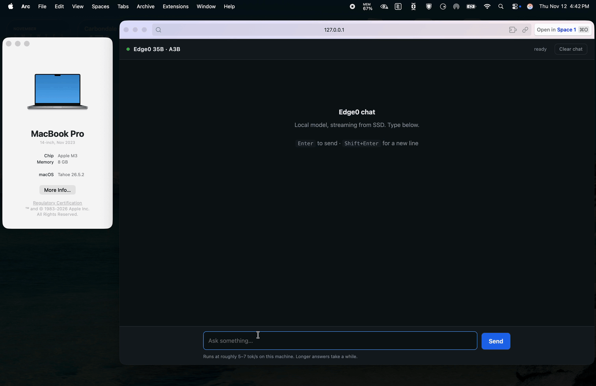

# 🧠 Running Edge0-35B-A3B on an 8 GB Mac

A **35-billion-parameter** sparse MoE model, answering questions on a base
**Apple M3 with 8 GB of unified memory** — at ~5.6 tokens/second, inside
**3.1 GiB** of RAM.

No cloud. No API key. No network. Just a model streaming itself off the SSD.

[](chat-demo.mp4)

[▶ Watch the full recording](chat-demo.mp4) — 2:03, 3024×1964. The preview above
is sped up 6×; the linked file plays in real time.

> 🔒 The **serial number** in the About panel was removed during encoding by
> filling that row with the panel's own background — nothing is drawn over the
> video. The chip and memory lines were left intact on purpose: they're the
> point of the demo.

---

## 🎯 The one-sentence version

> The model is never loaded whole. Its 19.5 GB of expert weights stay on disk
> and stream in four at a time, while a trained **prerouter** predicts what the
> next step needs so the disk reads hide behind the math.

---

## 🤔 Why LM Studio could not run it

This whole project started with an error:

```
❌ Failed to index the following folder:
   ~/.lmstudio/models/Edge0/Edge0-35B-A3B-preview
```

Two separate problems hid behind it.

### Problem 1 — a malformed adapter broke indexing

Each weight shard declares itself properly:

```json
{ "__metadata__": { "format": "mlx" } }
```

The two adapter files do **not**. Their metadata is doubly nested, with no
`format` key at all:

```json
{ "__metadata__": { "__metadata__": "{\"model\": \"edge0-35b\", ...}" } }
```

LM Studio treats every loose `.safetensors` file as a candidate model, reads
`format: null`, and throws:

```
Unsupported safetensors format: null
    at ModelIndexer.classify
```

One bad sidecar failed indexing for the **entire folder** — including four
perfectly healthy shards.

### Problem 2 — even fixed, it wouldn't have loaded

```
┌─────────────────────────────────────────────┐
│  LM Studio                                  │
│                                             │
│   19.5 GB of weights ──▶ 8 GB of RAM        │  ❌ 25.5 GiB needed
│                                             │
│   (loads everything up front, always)       │
└─────────────────────────────────────────────┘

┌─────────────────────────────────────────────┐
│  edge0                                      │
│                                             │
│   SSD 19.5 GB  ──▶  4 experts ──▶  RAM      │  ✅ 3.9 GiB used
│       ▲                            3.9 GiB  │
│       └──── prerouter predicts ◀────────────┘
└─────────────────────────────────────────────┘
```

LM Studio maps the whole checkpoint into memory. `edge0` streams it. That is
the entire difference — and the reason the model card says *"3 GiB active
memory"* while LM Studio estimates 25.5 GiB.

**Neither number is wrong. They describe different runtimes.**

---

## ⚙️ How the streaming actually works

```
                      one token
                          │
                          ▼
                 ┌─────────────────┐
                 │    Prerouter    │  trained head: predicts the NEXT
                 │  (trained head) │  step's expert routing
                 └────────┬────────┘
                          │  4 of 256 experts
                          ▼
     ┌──────────────────────────────┐
     │   Expert slots (4 resident)  │◀──────┐
     └──────────────┬───────────────┘       │
                    │                       │ streamed from SSD
                    ▼                       │ as routed
           ┌─────────────────┐              │
           │   Metal GPU     │──────────────┘
           │   (Apple M3)    │
           └────────┬────────┘
                    ▼
              tokens → UI
```

Measured on a single prompt: **3,619 expert loads**, **7.1 GB read from SSD**,
and only **99 late prefetches out of 4,620** (2 %).

---

## 🖥️ The machine

| | |
|---|---|
| 💻 | MacBook Pro 14″, Nov 2023 |
| 🧠 | Apple M3 · 8 GB unified memory |
| 🍎 | macOS Tahoe 26.5.2 |
| ⚡ | `edge0-infer` 0.2.0 · GGML 0.24.0 |
| 📦 | Model revision `e21098e7` |

---

## 🛠️ Setup, step by step

Total time: **~30 minutes**, most of it the one-off conversion.

```
HF repo ──▶ ~/models/Edge0-35B-A3B-preview     18 GB   (source, temporary)
                    │
                    │  make_assets.py   ⏱ 9m 24s
                    ▼
           ~/models/edge0-35b-assets           20 GB   (9 files, permanent)
                    │
                    ▼
        edge0-infer serve  ──▶  127.0.0.1:8000
                    │
                    ▼
        server.py (proxy)  ──▶  127.0.0.1:8080  ──▶  🌐 browser
```

### 0️⃣ Check your disk 💾

You need **~42 GB free**: 19.7 GB for the source weights + ~22 GB for the
converted assets.

```bash
df -h ~
```

> This machine started with **14 GiB** and had to clear caches and one duplicate
> model first. Don't skip this — running out mid-conversion is annoying.

### 1️⃣ Install the build tools 🔧

```bash
brew install cmake ninja
```

Needs CMake ≥ 3.21, Ninja, and the Xcode command-line tools.

### 2️⃣ Clone and build the engine 📥

```bash
git clone --depth 1 https://github.com/Edge0-AI/Edge0.git ~/edge0
cd ~/edge0/edge0-infer
cmake --preset mac-metal
cmake --build --preset mac-metal
```

Verify it knows the model:

```bash
build/mac-metal/bin/edge0-infer info
```

```
✅ engine.version: 0.2.0
✅ model.0: edge0_35b
✅ device.0: backend=metal name=MTL0 description="Apple M3"
```

### 3️⃣ Move the model out of LM Studio 📂

The adapters must live **inside** the model folder — `edge0` loads them
automatically. And keeping it under `~/.lmstudio/models/` just keeps
re-triggering the indexer.

```bash
mkdir -p ~/models
mv ~/.lmstudio/models/Edge0/Edge0-35B-A3B-preview ~/models/Edge0-35B-A3B-preview
rmdir ~/.lmstudio/models/Edge0
```

> 💡 LM Studio should ideally not see this folder at all. It cannot run it, and
> the adapters only confuse its indexer.

### 4️⃣ Set up the asset tools 🐍

```bash
cd ~/edge0/edge0-infer
uv sync --project tools/assets
```

Convenience wrapper used below:

```bash
assets_py() { uv run --project tools/assets --no-sync python -I "$@"; }
```

### 5️⃣ Convert the weights 🔄

Optional sanity check that the upstream files still match their pinned digests
(fetches metadata only, no weights):

```bash
assets_py tools/assets/edge0_35b/fetch_source.py probe
```

Then convert:

```bash
assets_py tools/assets/edge0_35b/make_assets.py \
  --source ~/models/Edge0-35B-A3B-preview \
  --out    ~/models/edge0-35b-assets
```

```
⏱  9m 24s on this M3
📦 20 GB out, 9 files
📄 base.gguf · lora.gguf · prerouter.gguf · tokenizer.json · model.json …
```

> The docs quote 3–4 minutes on an M-series Mac. A base M3 takes longer.
> Both are fine.

### 6️⃣ Verify the assets ✅

```bash
assets_py tools/assets/check_assets.py check ~/models/edge0-35b-assets
```

```json
{
  "status": "passed",
  "model": "edge0_35b",
  "structure": "passed",
  "integrity": "passed",
  "tensors": "passed",
  "issues": []
}
```

### 7️⃣ Run it 🚀

```bash
# one prompt
build/mac-metal/bin/edge0-infer run \
  --model ~/models/edge0-35b-assets --device metal \
  --user "Introduce yourself in one sentence." --max-tokens 96

# interactive chat
build/mac-metal/bin/edge0-infer chat \
  --model ~/models/edge0-35b-assets --device metal

# OpenAI-compatible server
build/mac-metal/bin/edge0-infer serve \
  --model ~/models/edge0-35b-assets --device metal
```

```
🎉 Listening: http://127.0.0.1:8000   model=edge0_35b
```

```bash
curl -s localhost:8000/v1/chat/completions \
  -H 'content-type: application/json' \
  -d '{"model":"edge0_35b","messages":[{"role":"user","content":"hi"}],"max_tokens":64}'
```

---

## 💬 The chat window

`serve` is API-only — there's no built-in web page. The official **Edge0 Chat**
desktop app exists, but it needs Node 24+ and a full Rust/Tauri compile.

So this folder has a two-file front end instead:

```
┌────────────────────┐        ┌────────────────────┐        ┌──────────────┐
│  browser :8080     │  ────▶ │  server.py (proxy) │  ────▶ │  engine      │
│  index.html        │        │  same origin       │        │  :8000       │
└────────────────────┘        └────────────────────┘        └──────────────┘
```

### 🤨 Why the proxy?

`edge0-infer serve` doesn't answer CORS preflight:

```bash
$ curl -X OPTIONS localhost:8000/v1/chat/completions
HTTP/1.1 404 Not Found
```

A page served from any other port gets blocked by the browser. Running the page
**and** the proxy on the same origin removes CORS from the picture entirely.

### ▶️ Start it

```bash
cd ~/edge0/edge0-infer
nohup build/mac-metal/bin/edge0-infer serve \
  --model ~/models/edge0-35b-assets --device metal > ~/edge0-serve.log 2>&1 &

nohup python3 ~/edge0-chat/server.py 8080 > ~/edge0-chat/server.log 2>&1 &

open http://127.0.0.1:8080
```

### ⏹️ Stop it

```bash
pkill -f 'edge0-infer serve'
pkill -f 'edge0-chat/server.py'
```

Both bind to `127.0.0.1` only — not reachable from the LAN, and nothing leaves
the machine during inference.

---

## 📈 Measured performance

| | |
|---|---|
| 🚀 Decode | **5.6 tok/s** median (5.22–5.75) |
| ⏱️ First token | 3.0–3.8 s |
| 🧠 Peak runtime budget | 3.9 GiB |
| 📉 Peak physical footprint | **3.11 GiB** |
| 🖥️ Server resident | 3.0 GB · 4.5–6.3 tok/s |
| 💾 Experts streamed | 3,619 loads · 7.1 GB read |

Method: three runs of the same prompt, 200 tokens each, `--temperature 0`,
nothing else loaded. Decode rate is the engine's own reported figure
(`decode_forwards / decode_seconds`).

Runtime configuration it settles into:

```
routing: predicted    expert_slots: 4    experts: slots    lora: on
```

The model card quotes **15 tok/s** on a Mac mini **M4 Pro with 24 GB**. A base
M3 with 8 GB lands lower. The headline is the memory figure, not the speed.

---

## 🔍 Verifying it's the real model

Ask these three, ideally with greedy decoding. They pin down lineage, numeric
reasoning, and format obedience — and they reproduce word-for-word.

```bash
build/mac-metal/bin/edge0-infer run \
  --model ~/models/edge0-35b-assets --device metal \
  --temperature 0 --presence-penalty 0 --max-tokens 80 \
  --user "<question>"
```

| Ask | Expect |
|---|---|
| Name the organization that trained your base model and state your model family, in one sentence. | `I am Qwen, a large language model developed by Alibaba Group's Tongyi Lab.` |
| A shop sells pens at 7 for $12. How much do 23 pens cost? Show one line of arithmetic, then the final amount. | `$23 \times \frac{12}{7} \approx 39.43$` |
| List the prime numbers between 20 and 30 in ascending order, comma-separated, and output nothing else. | `23, 29` |

> ⚠️ The web UI runs at temperature 0.7, so wording varies there. Use
> `--temperature 0` for byte-identical output.

---

## 🧯 Troubleshooting

| Symptom | Cause | Fix |
|---|---|---|
| `Failed to index` in LM Studio | adapter files break its classifier | keep the model outside `~/.lmstudio/models/` |
| `Unsupported safetensors format: null` | adapter metadata lacks `format` | same — or remove the adapters from that tree |
| Truncated output, exit code 1 | two engines loaded at once on 8 GB | stop `serve` before running CLI prompts |
| `Address already in use` | engine already running | `pkill -f 'edge0-infer serve'` |
| Chat page loads but replies fail | proxy not running | `python3 ~/edge0-chat/server.py 8080` |
| Very slow first response | Metal shaders compiling | one-time cost; later runs are faster |
| Long answers get sluggish | KV cache grows past 16K context | start a new chat with **Clear chat** |

---

## 📁 Files in this folder

| File | What it is |
|---|---|
| `README.md` | this guide |
| `index.html` | chat UI — streaming, live tok/s, stop + clear buttons |
| `server.py` | same-origin proxy (page ⇄ engine) |
| `chat-demo.mp4` | the demo recording |
| `chat-preview.gif` | inline preview, sped up 6× |
| `LICENSE` | MIT, covering the scripts and docs |
| `.gitignore` | blocks logs, env files, and model weights |

Elsewhere:

| Path | Size | What |
|---|---|---|
| `~/edge0` | 504 MB | repo + `mac-metal` build |
| `~/models/edge0-35b-assets` | 20 GB | converted assets — all the engine needs |
| `~/edge0-serve.log` | — | engine log |

---

## 🔐 Security & privacy

- **Nothing leaves the machine.** The engine binds `127.0.0.1:8000`, the chat
  proxy `127.0.0.1:8080`. Loopback only — not reachable from the LAN or the
  internet.
- **No accounts, no API keys, no telemetry.** Prompts and replies are never
  transmitted. There is no analytics call anywhere in the pipeline.
- **No credentials in this repository.** It holds source and a recording only.
  `.gitignore` blocks `.env`, logs, and any `*.gguf` / `*.safetensors` weights
  so they can't be committed by accident.
- **Model files stay outside the repo.** The 20 GB of assets live in
  `~/models/edge0-35b-assets`; only the scripts and the demo video are tracked.
- **Small enough to audit.** `server.py` is 166 lines and forwards exactly one
  endpoint (`/v1/chat/completions`) to the engine. `index.html` is a single
  file with no external scripts, fonts, or CDN references.
- **No conversation text is logged.** The engine writes timings and memory
  figures to `~/edge0-serve.log`; the proxy logs nothing at all.

## ⚠️ Disclaimer

This project is provided for educational and informational purposes only. It
documents one person's setup on one machine — it is not a support contract, a
hardware recommendation, or a claim that every model behaves the same way.

Benchmark figures here are single-machine measurements and will vary with
prompt, context length, thermal state, and background load. Model output can be
wrong, biased, or unsafe; verify anything you intend to rely on.

Not affiliated with Edge0, Qwen, Alibaba, or Apple. Use at your own risk. The
author assumes no responsibility or liability for any errors, omissions, or
outcomes resulting from use of this guide or these scripts.

---

## 📚 Credits & licensing

- **Model** — [Edge0/Edge0-35B-A3B-preview](https://huggingface.co/Edge0/Edge0-35B-A3B-preview),
  4-bit sparse MoE derived from `Qwen/Qwen3.6-35B-A3B`
- **Runtime** — [Edge0-AI/Edge0](https://github.com/Edge0-AI/Edge0), Apache-2.0
- **Paper** — [The Other Half of the Memory Wall: Serving 35B MoEs from SSD with
  Trained Routing Prediction](https://arxiv.org/abs/2609.18063)

Model weights carry the Edge0 Community Model License 1.0 alongside upstream
Qwen terms; framework code is Apache-2.0. Check both before redistributing or
offering commercial model services.
